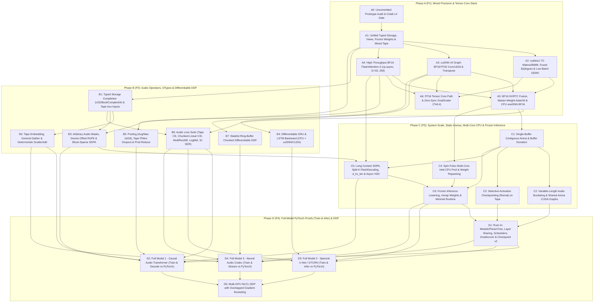

# Post-MVP Work Breakdown Plan: Phases A–D (Comprehensive PyTorch Leadership)

**Date:** 2026-11-23  
**Status:** Active execution plan (PyTorch-only competitive target across training & inference + mandatory per-step measurement; external framework / C++ inference engine comparisons deferred).  
**Related:** [roadmap.md](roadmap.md), [competitive-analysis-v1.md](competitive-analysis-v1.md), [architecture.md](architecture.md), [operator-coverage.md](operator-coverage.md), [benchmarking.md](benchmarking.md), [progress.md](progress.md), [colab-hardware-evaluation.md](colab-hardware-evaluation.md).

## 1. Strategic Objective and Six Governing Architectural Decisions

Per the 2026-11-23 direction adjustment, `fast-audio` focuses exclusively on **comprehensively beating PyTorch `2.14+`** across Intel CPUs and NVIDIA GPUs before comparing against any other ML framework or standalone C++ inference engine:

- **Training Objective:** Comprehensively beat **PyTorch `2.14+`** (`autocast(bfloat16/float16) + torch.compile + CUDA Graph` on NVIDIA GPUs; single- and multi-threaded `Inductor + oneDNN/MKL` on Intel CPUs) in step throughput, peak memory, and wall-clock `Time-to-Train (TTT)` to matched convergence quality across real audio models.
- **Inference Objective:** Comprehensively beat **PyTorch `2.14+`** (`torch.inference_mode()` + Eager, `torch.compile(inductor)`, `autocast(bfloat16/float16)`, static KV-cache, and CUDA Graph on NVIDIA GPUs; multi-threaded `Inductor + oneDNN/MKL` on Intel CPUs) in latency, `RTFx`/`tokens/s`, `p95`/`p99` tails, cold-start cost, and memory footprint across offline, chunked/streaming, and autoregressive decode audio workloads.
- **No External-Framework Comparisons For Now:** Benchmarks and parity gates against other ML frameworks and standalone C++ inference engines are explicitly deferred until comprehensive PyTorch leadership is confirmed.

This plan decomposes the four post-MVP priorities into **25 atomic, dependency-ordered tickets (`A0–A6`, `B1–B7`, `C1–C6`, `D1–D5`)**, governed by six binding architectural decisions:

1. **Eliminate the "Two Worlds" Split (`A1`/`A5`):** Unify `DType::{F32, Bf16, F16}` and typed auxiliary inputs (`I64`, `U32`, `Bool`, `Complex64`) directly into `Storage`, `Layout`/views, `autograd::Builder`, and `Tape`. Retain the uncommitted `Bf16AudioTransformerTrainer` in [src/cuda/mixed.rs](../src/cuda/mixed.rs) only as an `A0` baseline anchor and retire it once the unified BF16 `Tape` matches or exceeds its speed in `D2`.
2. **Mandatory `A0` Prototype Qualification Gate:** Audit, test (local Miri, Colab `fa-cpu`, Colab `L4` `compute-sanitizer`, PyTorch `2.14.1` BF16 cross-checks), benchmark, and cleanly commit the existing uncommitted prototype code before starting new Phase A–D development.
3. **Precision Order Aligned to Verified Hardware:** Colab provides NVIDIA `L4 (sm_89)`, `A100 (sm_80)`, `G4 (sm_120)`, and `T4 (sm_75)` with CUDA `13.0` and cuDNN `9.14.0` (`H100` is ineligible; see [colab-hardware-evaluation.md](colab-hardware-evaluation.md)). Deliver **`BF16 + TF32`** first (`sm_80`/`sm_89`/`sm_120`) and isolate **`FP16 + zero-sync GradScaler`** in `A6` (`sm_75`/`sm_89`). Defer training-time `FP8` and post-training weight-only quantized inference (`W8A16`/`W4A16`/INT8) until after Phase D passes against PyTorch.
4. **Hybrid SDPA + Decode Strategy:** Own our custom `mma.sync` + `cp.async` FlashAttention-2 kernel (`native/sdpa_bf16.cu`) for arbitrary/block-sparse audio masks, GQA, zero-atomic backward, and `T_q=1` Split-K `FlashDecoding` (with device-side `d_kv_len` single-CUDA-Graph decode), while wiring **cuDNN v9 Graph SDPA** as a ceiling benchmark oracle and optional unmasked fast route.
5. **One Model Definition, Two Lowered Execution Engines (`TrainingTape` + `FrozenInferencePlan`):** Models authored with `Builder` / `nn::Module` compile either to a full reverse-mode `TrainingTape` or to a zero-autograd `FrozenInferencePlan` (`C6`) equipped with static inference passes (Norm/BN folding, horizontal `QKV`/`Gate+Up` fusion, load-time microkernel weight repacking, single-buffer contiguous byte arena, 64B-aligned `mmap` weights, static/ring KV-Cache, and Cargo feature-trimmed minimal runtime) to decisively outperform PyTorch inference modes as well as training modes.
6. **Mandatory "Measure Every Step" Discipline:** No ticket `A0–D5` may close without a recorded **Step Measurement Receipt** (Section 7) verifying before/after latency, `p95`/`p99` tails, roofline bandwidth/FLOPS, zero hot-path allocations, exact memory breakdown, and same-session paired comparison against **PyTorch `2.14+`** (strongest compatible training and/or inference mode) under strict Colab CPU/GPU session isolation ([AGENTS.md](../AGENTS.md)).

---

## 2. Master Dependency DAG

---

## 3. Phase A (Priority 1): Explicit Mixed Precision (`BF16`/`FP16`/`TF32`) and Tensor Core Stack

**Objective:** Close the 4–8x GPU throughput gap against PyTorch `autocast(bfloat16) + torch.compile + cudagraph`, unify mixed precision inside `autograd::Tape` without regressing strict FP32, and establish low-batch GEMV foundations to beat PyTorch in both training and inference.

### `A0` — Uncommitted Prototype Audit, Qualification, and Baseline Freeze
- **Status:** Open. The [prototype screen](progress.md#2026-11-23--a0-prototype-screen-and-cross-entropy-stabilization) and [SDPA fallback screen](progress.md#2026-11-23--bf16-sdpa-fallback-and-gtcrn-c-inference-screen) record initial correctness and performance measurements.
- **Depends on:** None.
- **Scope & Target Files:** Audit and stabilize [src/dtype.rs](../src/dtype.rs), [src/embedding.rs](../src/embedding.rs), [src/rope.rs](../src/rope.rs), [src/dropout.rs](../src/dropout.rs), [src/loss.rs](../src/loss.rs), [src/cuda/mixed.rs](../src/cuda/mixed.rs), [src/cuda/audio_ops.rs](../src/cuda/audio_ops.rs), [native/bf16_tc.cu](../native/bf16_tc.cu), [native/sdpa_bf16.cu](../native/sdpa_bf16.cu), [native/audio_ops.cu](../native/audio_ops.cu), and [tests/phase_ab_cpu.rs](../tests/phase_ab_cpu.rs). Finalize CUDA test/benchmark coverage (`tests/bf16_tc_cuda.rs`, `tests/audio_ops_cuda.rs`, `tools/check_phase_ab.py`, `tools/bench_bf16_vs_pytorch.py`), resolve tracking/exclusion of `website/`, and refresh `CODEMAP.md` files.
- **Step Measurement & Exit Gate:**
  - Local portable CPU: `fmt`/`clippy` 0 warnings, `phase_ab_cpu` pass, Miri **0 UB**.
  - Colab `fa-cpu` (`--features mkl,onednn`): full suite + CPU PyTorch cross-check pass.
  - Colab `fa-gpu` (`L4 sm_89`, `--features cuda,cudnn`): full suite + `compute-sanitizer` (`memcheck`/`racecheck`/`synccheck`) **0 errors / 0 hazards**, per-op & multi-step `Bf16AudioTransformerTrainer` trajectories match PyTorch `2.14.1` `autocast(bfloat16)`, **Step Measurement Receipt** (cold/warm median/p95/p99, GB/s, peak VRAM vs PyTorch BF16 Eager/Compile/CUDA Graph) logged in [progress.md](progress.md), and clean commit.

### `A1` — Unified Typed Storage, Views, Frozen Inference Weights, and Mixed-Precision `Tape`
- **Status:** Partial prototype (contiguous `Bf16Tensor`/`DeviceBf16Tensor` only; `Tape` is strict FP32).
- **Depends on:** `A0`.
- **Scope & Target Files:** Refactor `src/tensor.rs`, `src/storage.rs`, `src/view.rs`, `src/cuda.rs`, `src/cuda/views.rs`, `src/autograd.rs`, `src/autograd/{prepare,engine,backend,host}.rs`, and `src/cuda/tape.rs`. Add explicit `DType::{F32, Bf16, F16}` on owned storage, strided views, `Shared`, and `SavedValue`; add differentiable `Cast` op + VJP (zero silent implicit casts); add an explicit **immutable `FrozenWeight` / `WeightLayout` abstraction** (zero `Tracked` version-check overhead for inference plans); author `docs/mixed-precision-v1.md`.
- **Step Measurement & Exit Gate:** Zero regression on all strict-FP32 tests; Miri **0 UB** on `Bf16`/`F16` views & `Cast` VJP; composed mixed-precision `Tape` passes PyTorch `autocast(bf16)` parity; Step Measurement Receipt verifies `Cast` achieves **>= 80% HBM bandwidth** on `L4` and strict-FP32 latency delta is within noise (`<= 2%`).

### `A2` — `cublasLt` Tensor Core `Matmul`/`Bmm`, Fused Epilogues, and Low-Batch `GEMV`
- **Status:** Prototype uses `cublasGemmEx` without `cublasLt` heuristics, epilogues, or dedicated `M=1..8` GEMV.
- **Depends on:** `A1`.
- **Scope & Target Files:** Upgrade `native/matmul.{h,cu}`, `native/bmm.{h,cu}`, `native/bf16_tc.cu`, `src/cuda/{matmul,bmm}.rs`, and `src/cuda/tape.rs`. Integrate `cublasLtMatmul` with heuristic algorithm caching (`cublasLtMatmulAlgoGetHeuristic`) respecting bounded workspace and determinism; support `BF16` (FP32 acc) and `TF32` for rank-2 `Matmul` and arbitrary-rank broadcast `Bmm` forward/`dA`/`dB`; add fused `Bias` + `SiLU`/`GELU` epilogues; add a dedicated **warp-reduced BF16/FP16 `GEMV` fast path for `M = 1..8`** (for low-batch and autoregressive audio inference where standard GEMM underutilizes HBM bandwidth); wire into `cuda::Tape`.
- **Step Measurement & Exit Gate:** Full transposed/strided/broadcast/empty/accumulate parity + `compute-sanitizer` 0 errors; Step Measurement Receipt on Colab `L4` & `A100` proves: (1) training dense shapes (`M = 512..8192`) achieve **>= 0.98x** PyTorch `bf16` `cublasLt` (**>= 1.05x** with epilogue fusion), and (2) `M = 1..4` BF16 GEMV reaches **>= 80% peak HBM bandwidth**, beating PyTorch `bf16` (`Eager` and `torch.compile` + CUDA Graph) on low-batch projections.

### `A3` — cuDNN v9 Graph `BF16`/`TF32` Convolutions (1D/2D and Transposed)
- **Status:** Greenfield ([native/cudnn.cu](../native/cudnn.cu) is strict FP32 NCHW only).
- **Depends on:** `A1`.
- **Scope & Target Files:** Extend `native/cudnn.cu`, `src/cuda/{cudnn,conv,conv2d}.rs`, `src/conv.rs`, and `src/cuda/tape.rs`. Use cuDNN 9.14 Backend Graph API for `CUDNN_DATA_BFLOAT16` and `TF32` (with `CUDNN_DATA_FLOAT` compute) covering `Conv1d`/`Conv2d`/`ConvTranspose1d`/`ConvTranspose2d` forward, `dX`, and `dW`; add Channels-Last (`NHWC`/`NLC`) Tensor Core layout support + fused Bias/Act epilogue for inference; preserve determinism filtering and workspace caps; wire into `cuda::Tape`.
- **Step Measurement & Exit Gate:** Grouped, depthwise, dilated, strided, and `output_padding` cases (DAC/EnCodec/GTCRN/Demucs shapes) pass PyTorch `2.14.1` `autocast(bfloat16)` + `compute-sanitizer`; Step Measurement Receipt on `L4`/`A100` shows **>= 2.5x** speedup over strict-FP32 Conv and **>= 1.00x** vs PyTorch `bf16` cuDNN (both training and inference forward-only).

### `A4` — High-Throughput `BF16` FlashAttention-2 (`cp.async`, `D = 32..256`, `Tape` Integration)
- **Status:** Prototype ([native/sdpa_bf16.cu](../native/sdpa_bf16.cu)) implements `mma.m16n8k16` for `D = 64|128` without `cp.async` pipelining or `Tape` integration.
- **Depends on:** `A1`.
- **Scope & Target Files:** Upgrade `native/sdpa_bf16.cu`, `src/sdpa.rs`, `src/cuda/sdpa.rs`, and `src/cuda/tape.rs`. Add SM80+ `cp.async` double-buffered SMEM prefetching, occupancy tuning, Tensor Core paths for `D in {32, 64, 80, 96, 128, 256}`, reduced GQA backward scratch, zero-LSE-write inference fast path, optional cuDNN v9 Graph SDPA benchmark/fallback route, and unified `cuda::Tape` dispatch.
- **Step Measurement & Exit Gate:** MHA/GQA, causal/non-causal, non-multiple `T`, and strided views match PyTorch FA2 with **0 atomics** and **0 sanitizer hazards**; Step Measurement Receipt on `L4`/`A100` (`T = 512..4096, D = 64/128`) achieves **>= 1.00x–1.15x** vs PyTorch `sdpa(flash/cudnn, bf16)` in both training (fwd+bwd) and prefill inference (fwd-only).

### `A5` — Mixed-Precision NVRTC Fusion, Master-Weight `AdamW`, and Intel CPU `BF16`/oneDNN
- **Status:** NVRTC fusion is FP32-only; `Bf16MasterAdamW` is standalone; CPU has no BF16 oneDNN route.
- **Depends on:** `A2`, `A3`, `A4`.
- **Scope & Target Files:** Extend `src/autograd/fusion.rs` and `native/nvrtc_fusion.cu` to emit BF16 I/O + FP32 internal accumulation kernels (pointwise chains, Residual+RMSNorm/LayerNorm, SwiGLU, Softmax/LogSoftmax tails); unify `Bf16MasterAdamW` into `src/optim.rs` and `cuda::Tape::step_scalar_adamw_captured`; extend `native/onednn.cpp` and `src/onednn.rs` with runtime-detected Intel CPU `BF16` (AVX-512 BF16 / AMX) routes and portable fallback.
- **Step Measurement & Exit Gate:** Arbitrary BF16 `Tape` models execute in one CUDA Graph without recapture; Step Measurement Receipt on Colab `L4`/`A100` achieves **>= 1.15x geomean** throughput vs PyTorch `2.14.1` `bf16 + torch.compile + cudagraph` with matched 50-step loss trajectories (`rel_err <= 2e-2`), plus verified Intel CPU BF16/fallback measurements vs PyTorch CPU Inductor on `fa-cpu`.

### `A6` — IEEE `FP16` Tensor Core Path and Zero-Sync `GradScaler`
- **Status:** Only scalar `f32_to_f16` and standalone `CudaGradScaler` exist.
- **Depends on:** `A2`, `A3`, `A4`.
- **Scope & Target Files:** Add `F16Tensor` / `DeviceF16Tensor`, `cublasLt` FP16 GEMM/BMM + low-batch FP16 GEMV, cuDNN v9 FP16 Conv, and FP16 FlashAttention-2 (with `T4 sm_75` compatibility); wire device-side `CudaGradScaler` overflow skip directly inside single-CUDA-Graph `cuda::Tape` replay.
- **Step Measurement & Exit Gate:** Verified on both Colab `T4 (sm_75)` and `L4 (sm_89)` including injected `Inf`/`NaN` overflow skip without host sync; 50-step trajectory matches PyTorch `autocast(float16) + GradScaler`; Step Measurement Receipt logs `T4` & `L4` FP16 throughput/bandwidth beating PyTorch FP16; `compute-sanitizer` 0 errors.

---

## 4. Phase B (Priority 2): Audio-Model Operator, Dtype, and Differentiable DSP Closure

**Objective:** Close every missing dtype, differentiable operator, and zero-copy streaming DSP primitive needed to run and beat PyTorch on audio Transformers/Conformers, Spectral U-Nets, GTCRN, and Neural Audio Codecs.

### `B1` — Complete Typed Storage (`U32`, `Bool`, `Complex64`) and Non-Differentiable `Tape` Aux Inputs
- **Status:** Only `F32`/`Bf16`/`F16`/`I64` exist; `Builder` accepts only float leaves.
- **Depends on:** `A1`.
- **Scope & Target Files:** Extend `src/dtype.rs`, `src/storage.rs`, `src/cuda.rs`, and `src/autograd.rs` with owned/strided `U32`, `Bool`, and `Complex64` storage, zero-copy `Complex64 <-> [..., 2] F32` views, differentiable complex ops (conjugate, multiply, `eps`-stabilized magnitude), and typed non-differentiable `IndexInput`/`MaskInput` leaves.
- **Step Measurement & Exit Gate:** Miri **0 UB**, `compute-sanitizer` **0 errors**, FP64/PyTorch parity; Step Measurement Receipt confirms complex ops reach **>= 80% memory bandwidth**, beat PyTorch Eager/Inductor, and perform zero implicit casts.

### `B2` — `Tape` `Embedding`, General `Gather`, and Deterministic `ScatterAdd`
- **Status:** `Embedding` is standalone; general `Gather`/`ScatterAdd` are missing.
- **Depends on:** `B1`.
- **Scope & Target Files:** Wire `Embedding` into `Builder`/`Tape` (F32 & BF16); add arbitrary-axis `Gather`, `IndexSelect`, and deterministic zero-atomic (or fixed-order segmented) `ScatterAdd` supporting RVQ codebooks and STE gradients; author `docs/indexing-v1.md`.
- **Step Measurement & Exit Gate:** Large-vocab (`V = 1024..65536`) and high-collision duplicate-index parity vs PyTorch on CPU & CUDA; `compute-sanitizer racecheck` **0 hazards**; Step Measurement Receipt beats PyTorch Eager and compiled baselines on both CPU & GPU.

### `B3` — Arbitrary Audio Attention Masks, Sequence Packing (`cu_seqlens`), Device-Offset `RoPE`, and Block-Sparse `Sdpa`
- **Status:** `Sdpa` supports only causal/none; `RoPE` supports only static host offset FP32 on `Tape`.
- **Depends on:** `B1`, `A4`.
- **Scope & Target Files:** Extend `src/sdpa.rs`, `native/sdpa.cu`, and `native/sdpa_bf16.cu` for `2D`/`4D` `Bool` masks, additive `F32`/`BF16` bias masks (ALiBi/relative bias/padding), and **block-skipping sparse masks** (sliding-window, streaming chunk, and **Sequence Packing block-diagonal `cu_seqlens` masks** eliminating variable-length audio padding waste). Extend `src/rope.rs` and CUDA kernels with interleaved & half-split layouts, NTK/YaRN frequency scaling, BF16 `Tape` support, **per-packed-segment position reset**, and **optional device-side `d_pos_offset` scalar** (enabling single-CUDA-Graph autoregressive position increment without recapture).
- **Step Measurement & Exit Gate:** FP32 & BF16 parity vs PyTorch `sdpa(attn_mask=...)` / FlexAttention; Step Measurement Receipt proves block-skipping and packed-sequence masks deliver **>= 1.8x** speedup over padded dense SDPA and beat PyTorch masked SDPA / FlexAttention while staying 100% CUDA Graph capture-safe.

### `B4` — Differentiable `GRU` and `LSTM` Backward (`dX`, `dH0`, `dW`)
- **Status:** `GRU` is forward-only; `LSTM` does not exist.
- **Depends on:** `A3`.
- **Scope & Target Files:** Extend `src/gru.rs`, `native/gru.cu`, and add `src/lstm.rs`, `native/lstm.cu`, `src/cuda/rnn.rs`, and `docs/rnn-backward-v1.md`. CPU (oneMKL batched projections + AVX2 gate fusion) and CUDA (cuDNN v9 RNN training graph + custom fused persistent kernel for small hidden `H <= 192` like GTCRN) forward + `dX`/`dH0`/`dW` (uni/bidirectional, FP32 & BF16) on `Tape`.
- **Step Measurement & Exit Gate:** Closes GRU backward gap in [operator-coverage.md](operator-coverage.md); FP64 finite-diff + PyTorch `nn.GRU`/`nn.LSTM` parity; Step Measurement Receipt proves small-hidden GPU training beats PyTorch `nn.GRU`/`nn.LSTM` (Eager & compiled) by **>= 1.5x** and beats PyTorch on CPU & GPU forward inference; 0 sanitizer errors.

### `B5` — Pooling (`AvgPool`/`MaxPool` 1d/2d), `Tape` `Philox Dropout`, and `Prod` Reduction
- **Status:** `Dropout` is standalone; Pooling and `Prod` are missing.
- **Depends on:** `A1`.
- **Scope & Target Files:** Add `src/pool.rs`, `src/cuda/pool.rs`, `native/pool.{h,cu}` (`AvgPool1d/2d`, `MaxPool1d/2d` with argmax indices); wire `Philox4x32-10` `Dropout` into `Tape` with a **device-side auto-incrementing step counter** (single-CUDA-Graph safe and checkpointable); add `ReduceOp::Prod` (exact zero/multi-zero derivatives) to `src/reduce.rs` and `native/reduce.cu`.
- **Step Measurement & Exit Gate:** Bit-identical CPU vs CUDA Dropout masks across 10 consecutive CUDA Graph replays; Pooling & `Prod` match PyTorch & FP64; Miri & `compute-sanitizer` 0 errors; Step Measurement Receipt beats PyTorch Eager and compiled baselines on CPU & GPU.

### `B6` — Audio Loss Suite (`Tape` `CrossEntropy`, Fused Chunked `Linear+CrossEntropy`, `MultiResolutionStftLoss`, `LogMel`, `SI-SDR`)
- **Status:** `CrossEntropy` is standalone; fused chunked `Linear+CE` and spectral/acoustic losses are missing.
- **Depends on:** `B1`, `A5`.
- **Scope & Target Files:** Wire fused `CrossEntropy` (F32 & BF16, `O(1)` scratch) into `Tape`, plus add **Fused Chunked `Linear + CrossEntropy`** (tiling `[B*T, D] @ [D, V] + CE` over `BT` chunks so giant `[B*T, V]` audio token/codebook logits never materialize in HBM); add `src/audio_loss.rs` (`MultiResolutionStftLoss` over multiple `(n_fft, hop, win)` scales with fused tails, differentiable `MelFilterbank`/`LogMelSpectrogram`, `SiSdrLoss`, `L1Loss`).
- **Step Measurement & Exit Gate:** Exact parity vs PyTorch including silence/`eps` boundaries; Fused Chunked `Linear+CE` cuts output-layer peak VRAM by **>= 70%** vs materialized `[B*T, V]` logits; full `MultiResolutionStftLoss` fwd+bwd captures into **one CUDA Graph**; Step Measurement Receipt proves **>= 2.0x** speedup over PyTorch `torch.stft` multi-resolution loss step on `L4`.

### `B7` — Stateful Ring-Buffer Chunked Differentiable DSP (`ChunkedConv1d`, `PolyphaseResample`, `StreamingStft`/`Istft`)
- **Status:** Only offline whole-signal STFT/Conv exists.
- **Depends on:** `A3`.
- **Scope & Target Files:** Add `src/dsp_state.rs`, `src/resample.rs`, `native/dsp_state.{h,cu}`, and `docs/chunked-dsp-v1.md`. Implement explicit-state `process`/`flush`/`reset` contracts using **zero-`memmove` ring-buffer pointers** for causal `ChunkedConv1d`, differentiable rational `PolyphaseResample` (`16k/24k/44.1k/48k`, explicit group delay), and `StreamingStft`/`StreamingIstft` with NOLA tail accounting and truncated-BPTT gradients.
- **Step Measurement & Exit Gate:** Arbitrary chunk sizes (including non-hop tails and independent streams) match offline outputs (`max_abs <= 1e-5` FP32); FP64 alias-rejection/delay oracle pass; Step Measurement Receipt confirms **0 warmed allocations**, sub-millisecond per-chunk `p99` latency beating equivalent PyTorch chunked pipelines, and 0 sanitizer errors.

---

## 5. Phase C (Priority 3): System Scale, Static Memory Arenas, Multi-Core CPU, and Frozen Inference

**Objective:** Close all system scaling gaps (single-buffer zero-fragmentation arenas, variable-length audio bucketing, selective rematerialization, multi-core low-jitter CPU pool, long-context SDPA + static KV-cache decode + async H2D, and zero-autograd frozen inference lowering) to beat PyTorch across every runtime regime.

### `C1` — Single-Buffer Contiguous Byte Arena, Buffer Donation, and Exact Peak Accounting
- **Status:** Each activation/tensor slot allocates an independent host `Vec` or `cudaMalloc` block.
- **Depends on:** `A5`.
- **Scope & Target Files:** Add `src/arena.rs`, `src/cuda/arena.rs`, `native/cuda_arena.{h,cu}`, and `docs/memory-pool-v1.md`. Upgrade activation/scratch planning on **both CPU and CUDA** to a **single contiguous byte Arena sliced by 64B/256B-aligned static byte offsets** (plus session-scoped GPU pool for dynamic scratch), add explicit **Buffer Donation** on `Tape`, and report exact `weights`, `optimizer_state`, `saved_activations`, `arena_scratch`, `vendor_workspace`, and device high-water mark bytes.
- **Step Measurement & Exit Gate:** 1,000 prepare/run/drop cycles show **0 leaked bytes**, `< 2%` watermark drift, **0 hot-path `malloc`/`cudaMalloc` calls**, `compute-sanitizer memcheck` 0 errors; Step Measurement Receipt verifies CPU cache/TLB & GPU peak VRAM improvements over both pre-`C1` and PyTorch `CUDACachingAllocator`.

### `C2` — Variable-Length Audio Shape Bucketing, Sequence Packing, and Shared-Arena CUDA Graph Cache
- **Status:** Fixed static shapes only.
- **Depends on:** `C1`.
- **Scope & Target Files:** Add `src/autograd/bucket.rs` and `src/cuda/bucket.rs`. Implement `BucketedTapeCache` across geometric/custom audio duration buckets (`1s, 2s, 4s, 8s, 16s`) where **all buckets share one parameter/optimizer store and one max-bucket contiguous byte arena**, paired with **zero-allocation Sequence Packing (`cu_seqlens` bin-packing of variable-length audio clips into full buckets with `< 5%` padding waste)** and padding/mask helpers.
- **Step Measurement & Exit Gate:** 1,000 random switches across 5 duration buckets show **0 leaks**, activation VRAM strictly **1.0x single largest bucket**, warmed switch overhead **`< 20 us`**; Step Measurement Receipt proves clear throughput, effective-token Time-to-Train (**>= 1.4x** over naive padded batching), & p99 latency victory over PyTorch `torch.compile(dynamic=True)` with **0 recompilation stalls**.

### `C3` — Policy-Based Selective Activation Checkpointing (`Remat`) on `Tape`
- **Status:** All backward-required activations stay resident until consumed.
- **Depends on:** `C1`.
- **Scope & Target Files:** Extend `src/autograd.rs`, `src/autograd/{prepare,engine}.rs`, and `src/cuda/tape.rs` with `Builder::checkpoint_scope(RematPolicy)` supporting both **`RematPolicy::FullBlock`** and **`RematPolicy::SaveDotsOnly`** (retaining expensive Tensor Core GEMM/Conv/SDPA outputs while recomputing cheap bandwidth-bound Norm/SwiGLU/RoPE/pointwise ops), scheduled onto the shared static byte arena and `B5` device-counter Philox RNG inside a single CUDA Graph.
- **Step Measurement & Exit Gate:** Checkpointed vs uncheckpointed gradients match (`<= 1e-6` FP32; matched BF16 + Dropout masks); Step Measurement Receipt on a 12-layer Audio Transformer & deep U-Net proves **>= 45% peak activation VRAM reduction** at **<= 10% step-time cost (`SaveDotsOnly`) / <= 25% (`FullBlock`)** inside 1 CUDA Graph, beating PyTorch `torch.utils.checkpoint` on both speed and peak VRAM.

### `C4` — Spin-Then-Futex Multi-Core Intel CPU Pool, Weight Repacking, and Parallel Kernel Suite
- **Status:** CPU benchmarks qualify 1-thread execution only; no custom thread pool or general weight repacking.
- **Depends on:** `A5`.
- **Scope & Target Files:** Add `src/cpu_pool.rs`, `src/pack.rs`, and `docs/cpu-scaling-v1.md`. Build a **persistent worker pool** with pinned core affinity, configurable **short atomic spin window before futex sleep** (eliminating 20–50 us OS wakeup jitter on short audio frames), and synchronized MKL/oneDNN OpenMP thread control (zero oversubscription). Add **load-time microkernel weight repacking** (`pack_b` + bias interleaving for AVX2/AVX-512) and parallelize 2D L1-tiled fused regions, Flash SDPA, Norm/Softmax/RoPE/STFT, and Conv/Matmul fallbacks.
- **Step Measurement & Exit Gate:** 0 races under concurrency stress; Step Measurement Receipt on Colab `fa-cpu` (8 vCPUs, `threads = 1, 2, 4, 8`) proves **>= 2.8x** 4-thread scaling and beats multi-threaded PyTorch CPU (`Eager` and `Inductor + oneDNN/MKL`) across **>= 90% of the suite** in both training and forward inference.

### `C5` — Long-Context GPU SDPA (`T = 2k..16k`), Split-K `FlashDecoding`, `d_kv_len` KV-Cache, and Async H2D Staging
- **Status:** Long-context FP32 SDPA uses slow scalar `BR=32,BC=32`; no `T_q=1` Split-K decode or static KV-Cache; H2D copies block synchronously.
- **Depends on:** `A4`, `B3`, `C1`.
- **Scope & Target Files:** Upgrade `native/sdpa.cu` long-context FP32 to double-buffered 64x64 tiles and tune `native/sdpa_bf16.cu` for `T = 2048..16384`; add **`T_q = 1` Split-K `FlashDecoding`** and fixed-address static/ring **KV-Cache driven by device-side `d_kv_len` scalar** (autoregressive decoding `T_k = 1..16384` inside **one CUDA Graph, 0 recapture**); add `PinnedHostBuffer` + async `copy_stream` + CUDA event double-buffering in `src/cuda.rs` & `native/cuda.cu`.
- **Step Measurement & Exit Gate:** Strict `O(T)` memory through `T = 16384`; Step Measurement Receipt verifies: (1) BF16 `T = 4096..16384` training SDPA achieves **>= 1.00x–1.10x** vs PyTorch FA2 (FP32 **>= 2.0x** vs old fallback); (2) `T_q = 1, T_k = 4096` decode latency decisively beats PyTorch `torch.inference_mode()` + `sdpa` + `torch.compile` static-KV CUDA Graph; (3) `nsys` confirms **>= 85%** H2D transfer latency hidden under GPU compute with 0 sanitizer races.

### `C6` — Frozen Inference Graph Lowering, 64B-Aligned `mmap` Weights, and Minimal Runtime
- **Status:** Legacy `src/graph.rs` is FP32 rank-4 only and disconnected from `Builder`/BF16/Arena/KV-Cache.
- **Depends on:** `C1`, `C4`, `C5`.
- **Scope & Target Files:** Add `src/infer/` (`FrozenPlan`, static rewrite passes, `mmap` loader, `safetensors` reader) and Cargo feature split (`inference-only` / optional `training`). Lower any `Builder` graph with frozen weights into a zero-autograd `FrozenInferencePlan` applying: (1) automatic `Conv/Linear + BatchNorm/RmsNorm` folding, (2) horizontal `QKV` and `Gate+Up` weight merging, (3) `cublasLt`/cuDNN epilogue sinking, (4) `C4` load-time weight repacking, (5) `C1` single-buffer contiguous byte arena, and (6) **64B-aligned zero-copy `mmap` weight bundle** (+ `safetensors` import). Author `docs/inference-runtime-v1.md`.
- **Step Measurement & Exit Gate:** Full numerical equivalence (`max_abs <= 1e-5` FP32; within BF16 tolerance) vs unfused eager/`Tape` forward; cold-start load time `< 50 ms` via `mmap`; 0 hot-path allocations; Step Measurement Receipt on GTCRN + Transformer Block + Vocoder proves comprehensive FP32 & BF16 inference wins (latency, `p99`, cold-start, and RSS/VRAM) over PyTorch `2.14.1` (`torch.inference_mode()` + Eager, `torch.compile`, and CUDA Graph) on both Intel CPU and NVIDIA GPU.

---

## 6. Phase D (Priority 4): Full-Model PyTorch Leadership Proofs (Train & Infer), Ergonomics, and Multi-GPU

**Objective:** Prove end-to-end multi-epoch **training AND inference leadership over PyTorch `2.14+`** across three complete audio architectures on Intel CPU and NVIDIA GPU, deliver ergonomic Rust APIs, and extend to multi-GPU NCCL DDP.

### `D1` — Ergonomic Rust `nn` Module/Parameter Registry, Homogeneous Layer-Plan Sharing, LR Schedulers, Grad Accumulation, and `Checkpoint v2`
- **Status:** Only low-level `Builder` and flat `Vec` parameter lists exist.
- **Depends on:** `C2`, `C3`, `C6`.
- **Scope & Target Files:** Add `src/nn/` (`Module`, `ParamRegistry`, `Linear`, `Conv1d`/`2d`, `RmsNorm`/`GroupNorm`, `MultiHeadAttention`, `SwiGLU`, `Gru`/`Lstm`, `Embedding`), **homogeneous layer-block plan sharing** (so $L$ identical Transformer/ResBlock layers reuse prepared operator/fusion descriptors with $O(1)$ preparation time in $L$), `src/sched.rs` (`CosineWarmup`, `LinearDecay`, `OneCycle` writing directly to device `d_lr`), native `Tape` `grad_accum_steps`, and `Checkpoint v2` (schema, precision, optimizer, Philox RNG, scheduler, and `FrozenInferencePlan` export + `safetensors` interop).
- **Step Measurement & Exit Gate:** 12-layer Audio Transformer authored in `< 120` LOC lowers with **0% runtime overhead** and **>= 3x faster plan preparation** vs unrolled per-layer plan construction; `grad_accum_steps = 4` matches 4x batch; interrupt/resume trajectories match uninterrupted runs; Step Measurement Receipt confirms zero abstraction tax.

### `D2` — Full-Model Proof 1: Multi-Layer Causal Audio Transformer (12-Layer, ~50–100M)
- **Status:** Only single-block FP32 and hardcoded prototype trainer exist.
- **Depends on:** `B2`, `B3`, `B5`, `B6`, `C5`, `D1`.
- **Scope & Target Files:** Add `examples/train-audio-transformer.rs` and `tools/bench_full_transformer.py` (covering both training and autoregressive decode inference vs PyTorch). Build on unified `nn` + `Tape` (with Sequence Packing + Fused Chunked `Linear+CE` + `SaveDotsOnly` Remat) + `FrozenInferencePlan`; retire hardcoded `Bf16AudioTransformerTrainer` from `src/cuda/mixed.rs`.
- **Step Measurement & Exit Gate (Training + Inference vs PyTorch `2.14.1`):**
  - **Training (`bf16 + compile + cudagraph` on `L4`/`A100`; multi-threaded CPU Inductor on `fa-cpu`):** multi-epoch validation loss matches (`<= 1.0%`), step throughput **>= 1.15x tokens/s**, peak VRAM **<= 0.85x**, and **wall-clock `Time-to-Train (TTT)` to target validation loss (including preparation/compile + data staging + packing) beats PyTorch by >= 1.25x**.
  - **Autoregressive Decode Inference (`BS=1..4`, FP32 & BF16) vs PyTorch (`inference_mode` + `torch.compile` + static KV-cache + CUDA Graph):** decisively beats PyTorch on `tokens/s`, `TTFT`, `p99` per-token latency, and peak memory on both Colab `fa-cpu` and `L4`/`A100`.

### `D3` — Full-Model Proof 2: Multi-Scale Spectral Enhancement / Separation U-Net & Trainable GTCRN
- **Status:** GTCRN is inference-only; training benchmark is a 2-layer toy step.
- **Depends on:** `B4`, `B6`, `C6`, `D1`.
- **Scope & Target Files:** Add `examples/train-spectral-unet.rs` and `tools/bench_full_spectral_unet.py` (covering training + offline/chunked inference vs PyTorch). Train both full GTCRN-trainable and a deeper multi-scale Spectral U-Net (`CenteredStft + Conv2d/Transpose + GroupNorm + GRU + Istft + MultiResolutionStftLoss + SI-SDR`).
- **Step Measurement & Exit Gate (Training + Inference vs PyTorch `2.14.1`):**
  - **Training (`bf16 + compile`):** multi-epoch SI-SDR/loss matches (`<= 1.0%`), single-CUDA-Graph training throughput **>= 1.5x–3.0x** on `L4`/`A100`, and **wall-clock `Time-to-Train (TTT)` to target validation SI-SDR beats PyTorch by >= 1.5x**.
  - **Inference (offline & chunked) vs PyTorch (`inference_mode` + Eager / `torch.compile` / CUDA Graph):** decisively beats PyTorch on `RTFx`, `p99` frame latency, and memory footprint on both `fa-cpu` and `L4`/`A100`.

### `D4` — Full-Model Proof 3: Neural Audio Codec / Vocoder (DAC / EnCodec / Mimi Paradigm)
- **Status:** Only archived `docs/dac.md` research exists.
- **Depends on:** `B2`, `B6`, `B7`, `C6`, `D1`.
- **Scope & Target Files:** Add `examples/train-audio-codec.rs` and `tools/bench_full_codec.py` (covering training + offline/streaming inference vs PyTorch). Full encoder-RVQ-decoder codec (`Conv1d`/`ConvTranspose1d` + `Pad` + dilated residual blocks + RVQ `Embedding`/`ScatterAdd` + `MultiResolutionStftLoss`) plus causal streaming chunked inference (`B7` + `C6`).
- **Step Measurement & Exit Gate (Training + Inference vs PyTorch `2.14.1`):**
  - **Training (`bf16 + compile`):** multi-epoch waveform/spectral quality matches, GPU BF16 training throughput **>= 1.25x**, and **wall-clock `Time-to-Train (TTT)` to target multi-resolution spectral loss beats PyTorch by >= 1.25x**.
  - **Streaming & Offline Inference vs PyTorch (`inference_mode` + Eager / `torch.compile` / CUDA Graph):** causal chunk-vs-offline equivalence (`<= 1e-5` FP32), streaming first-frame latency, `p99`, and `RTFx` decisively beat PyTorch on both `fa-cpu` and `L4`/`A100`.

### `D5` — Multi-GPU Data Parallelism (`DDP` via NCCL)
- **Status:** Single-device only.
- **Depends on:** `D2`, `D3`, `D4` (gated strictly after single-device PyTorch proofs pass).
- **Scope & Target Files:** Add feature-gated (`--features nccl`) `src/cuda/nccl.rs`, `native/nccl_ddp.{h,cu}`, and `docs/ddp-v1.md` wrapping NCCL communicator, contiguous BF16/FP32 gradient bucketing, and async `ncclAllReduce` overlapped with backward via CUDA events.
- **Step Measurement & Exit Gate:** 2–4 GPU DDP matches single-GPU `grad_accum` loss trajectory; Step Measurement Receipt + `nsys` prove **>= 85% weak scaling efficiency** and beat matched PyTorch `DDP` with 0 compile/runtime overhead on single-GPU builds.

---

## 7. Mandatory "Measure Every Step" Protocol

Every single ticket **`A0` through `D5`** is incomplete until its **Step Measurement Receipt** is generated, archived under `benchmarks/results/`, and summarized in [progress.md](progress.md). Never accumulate multiple unmeasured tickets.

Each Step Measurement Receipt must record all six fields:

1. **Correctness & Safety Pre-Gate:**
   - Independent FP64 analytical/finite-diff oracle and PyTorch `2.14.1` numerical cross-check under declared precision tolerances.
   - Local `cargo fmt --check`, `cargo clippy --all-targets -- -D warnings`, and `cargo +nightly miri test` (**0 UB**).
   - Colab GPU `compute-sanitizer --tool memcheck`, `racecheck`, and `synccheck` (**0 errors, 0 hazards**).
2. **Before/After Controlled Delta:**
   - Exact latency/throughput comparison against the immediately preceding frozen commit on the same hardware session (verifying zero silent regressions on earlier strata).
3. **Full Latency Distribution & Cold/Warm Split:**
   - Preparation / packing / compilation time, first-call latency, warmed **median**, **`p95`**, **`p99`**, and domain throughput (`tokens/s`, `frames/s`, or `RTFx`).
4. **Roofline & Execution Efficiency Attribution:**
   - Achieved memory bandwidth (GB/s vs hardware ceiling: e.g., L4 ~300 GB/s, A100 ~1,935 GB/s, host DDR) or achieved TFLOPS, total kernel launch count (`nsys`), and hot-path allocation count (**must be 0**).
5. **Exact Memory / VRAM Breakdown:**
   - Separate accounting for `weights`, `optimizer_state`, `saved_activations`, `arena_scratch`, `vendor_workspace`, host RSS, and peak GPU VRAM.
6. **PyTorch Competitive Anchor (Same-Session Paired Comparison):**
   - **Training scope:** paired against **PyTorch `2.14.1`** strongest compatible training mode (`bf16`/`fp16`/`fp32` + Eager, `torch.compile(inductor)`, and CUDA Graph on GPU; single- and multi-threaded `Inductor + oneDNN/MKL` on CPU).
   - **Inference scope.** Pair the strongest compatible **PyTorch `2.14.1`** mode on the same session. Use `eval()` and `torch.inference_mode()`, plus static KV-cache for decode and CUDA Graph replay where supported.
   - Apply the [benchmark contract](benchmarking.md#current-external-baseline) to match workloads and record per-mode results. Follow the [Colab CPU/GPU isolation rules](colab-hardware-evaluation.md) for both training and inference comparisons.

---

## 8. Deferred Post-PyTorch Scope

The following items are intentionally excluded from Phases A–D until comprehensive leadership over PyTorch is verified:
- Benchmarking or parity work against other ML frameworks or standalone C++ inference engines.
- Post-training weight-only quantized inference (`W8A16`/`W4A16` CUDA GEMV and CPU `VNNI`/`AMX` INT8/INT4).
- Training-time `FP8` precision paths.
